  

  

    
    
    
  

  

    <strong>Frontend developer</strong>  
    <em>Building thoughtful interfaces with React, TypeScript & JavaScript.</em>
  

---

<h2 align="center">👋 About me</h2>

  Hi! I'm <strong>Vadim</strong> — a developer focused on frontend development and the modern JavaScript ecosystem. 
  I enjoy turning ideas into clean, responsive interfaces that feel intuitive to use.

  My main focus is <strong>React</strong>, <strong>TypeScript</strong> and <strong>JavaScript</strong>.
  I care about readable code, reusable components, thoughtful UI details and a consistent user experience.

## ✨ What I focus on

- 🎨 **Interface development** — creating clean, responsive layouts and intuitive user experiences.
- 🧩 **Component-based architecture** — building reusable UI components and keeping code easy to maintain.
- ⚡ **Modern JavaScript** — working with React, TypeScript and the tools around them.
- 📱 **Mobile development** — exploring native-feeling applications with React Native and Expo.
- 🔌 **Full-stack fundamentals** — learning how frontend applications communicate with APIs and databases.

## 🧰 Tech stack

### 💻 Frontend · Main stack

  
  
  
  
  

### 📱 Mobile · Currently building and exploring

  
  

### 🐍 Backend · Learning path

  
  
  

### 🛠 Tools & workflow

  
  
  
  

## 🌱 What I'm learning right now

<table>
  <tr>
    <td width="50%" valign="top">
      <h3>📲 React Native</h3>
      
Building mobile interfaces with Expo, exploring navigation, app structure and the details that make an app feel at home on iOS.

    </td>
    <td width="50%" valign="top">
      <h3>⚙️ Backend development</h3>
      
Learning Python, FastAPI and PostgreSQL, with a focus on REST APIs, data models and connecting a backend to a frontend application.

    </td>
  </tr>
</table>

## 🧭 My development principles

> Good interfaces should feel simple to use — and good code should be easy to understand.

- **Clarity first** — meaningful names, predictable structure and readable code.
- **Consistency matters** — reusable components and coherent design patterns.
- **Keep learning** — improve fundamentals, explore new tools and build real things.

## 🔗 Explore my work

  
  

I'm continuously learning, experimenting and improving through personal projects. Have a look around — more work will appear here as I build it.

---

  <h3>Thanks for visiting! ✨</h3>
  
<em>Always curious. Always building.</em>

  Vadim Kulishov · Frontend Development

